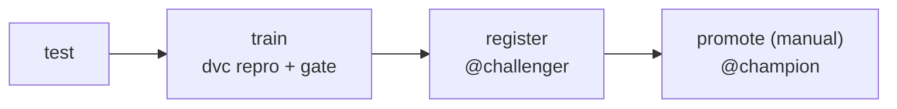

# CI/CD for ML

[← AI DevOps](README.md)

How the components in [What AI DevOps is](01-what-ai-devops-is.md) become a pipeline, using the [training pipeline](examples/gitlab/training/.gitlab-ci.yml) that runs end to end in the [GitLab lab](../gitlab/lab/README.md). It assumes the [GitLab CI/CD guides](../gitlab/README.md).

## The pipeline



| Job | Runs on | Does | Fails when |
|---|---|---|---|
| `test` | Every pipeline | ruff, mypy, pytest on the training code | The code is wrong |
| `train` | Every pipeline | `dvc repro` (prepare, validate, train, evaluate), then `wine-model gate` | Data is invalid, or the candidate is below the floors or worse than `@champion` |
| `register` | Default branch | Registers the model, points `@challenger` at it | |
| `promote` | Default branch, manual | Points `@champion` at the challenger: the release | |

Some decisions in it worth copying:

- **Merge requests train and gate, but don't register.** A merge request proves the change would produce a model that passes; only merged code produces models anyone may deploy. The gate needs the tracking server even on merge requests, because it compares against the champion.
- **The gate is a separate command after `dvc repro`**, not a DVC stage, so `dvc.lock` records the evaluation whether or not it passes, and the job log shows the metrics before the verdict.
- **The model is an artifact of `train`** (`models/`, `metrics.json`, `dvc.lock`), so a failed gate leaves something to inspect.
- **Promotion is a manual job with an environment and a resource group.** `environment: production` gives you GitLab's deployment history (who promoted what, when); `resource_group` stops two promotions racing. Both are in GitLab Free.
- **The job image is pinned by digest**, and the environment comes from `uv.lock`, so the pipeline that trains next month uses the same libraries.

```yaml
# Excerpt from examples/gitlab/training/.gitlab-ci.yml
train:
  extends: .uv
  stage: train
  needs: [test]
  # tags: [gpu]       # on a real platform, the runner with the hardware the model needs
  script:
    - uv run dvc repro
    - uv run dvc metrics show
    - uv run wine-model gate
  artifacts:
    paths: [metrics.json, models/, dvc.lock]
```

The job output on a passing run:

```text
{"accuracy": 1.0, "f1_macro": 1.0}
candidate {'accuracy': 1.0, 'f1_macro': 1.0}; champion none
gate: passed
```

And on a worse candidate (from the lab's check):

```text
candidate {'accuracy': 0.8222, 'f1_macro': 0.8146}; champion {'accuracy': 1.0, 'f1_macro': 1.0}
gate: accuracy 0.8222 is below 0.9
gate: f1_macro 0.8146 is below 0.9
gate: f1_macro 0.8146 regresses on the champion's 1.0 by more than 0.01
gate: failed
```

## Designing the gate

The gate is where the pipeline encodes "good enough to ship". The example's ([evaluate.py](examples/training/src/wine_model/evaluate.py)) has two parts, and most real gates need both:

1. **Absolute floors**: below these, never ship, whatever production has. They come from the product, not from the last model.
2. **No regression against the champion**, with a tolerance. Without tolerance, noise fails good models; with too much, quality erodes one release at a time.

Then add what your model needs: metrics **per segment** (a model that improves overall but gets worse for one customer group or language shouldn't ship), **latency and size** limits (a model that's twice as slow is a regression), and **fairness** checks where the use case requires them. Keep the thresholds in `params.yaml`, reviewed like code.

## Continuous training

Retraining is the same pipeline, triggered differently. In GitLab, a **pipeline schedule** (Build > Pipeline schedules) runs the default branch on a cron; the pipeline above needs no change, since a scheduled pipeline is a branch pipeline. Other triggers:

| Trigger | How | When it fits |
|---|---|---|
| A schedule | Pipeline schedule | Data arrives steadily; retrain weekly or nightly |
| New data | The data platform calls the [pipeline trigger API](https://docs.gitlab.com/ci/triggers/) when an extract lands | Batches of data on no fixed schedule |
| Drift | Monitoring alerts, and the alert's webhook triggers the pipeline | Retrain only when the inputs change enough to matter |
| A code or parameter change | A merge request | Always |

On a scheduled run the code hasn't changed, so `dvc repro` reruns only if the data did. Make the prepare stage pull the latest data (and record its version), or nothing is retrained.

Automatic retraining should **not** mean automatic release. Keep promotion manual until the gate has a track record; then automate it for low-risk models with a canary ([Serving and operating](08-serving-and-operating.md#releasing-a-new-model)).

## Where data and models live in CI

- **Don't put datasets or models in the GitLab cache or long-lived artifacts.** They're slow and expensive at gigabyte sizes. Use a DVC remote (`dvc pull` at the start, `dvc push` at the end) or the tracking server's artifact store.
- **Credentials:** jobs reach the tracking server, the DVC remote, and the gateway with CI/CD variables. For cloud storage, use OIDC ([variables, secrets, and cloud access](../gitlab/06-variables-secrets-and-cloud-access.md)) rather than long-lived keys.
- **Metrics in merge requests:** GitLab's metrics report (`artifacts:reports:metrics`) shows metric changes in the merge request, but needs Premium or Ultimate ([artifacts reports](https://docs.gitlab.com/ci/yaml/artifacts_reports/)). On Free, `dvc metrics diff main` in the job log does the same job.

## Running it

The [GitLab checks](../../scripts/check_gitlab_examples.py) run this pipeline in the lab: `python scripts/check_gitlab_examples.py ai`, with both the [GitLab lab](../gitlab/lab/README.md) and the [AI DevOps lab](lab/README.md) up. It pushes the training example as a project, checks every job's status, plays `promote`, confirms `@champion` points at a run tagged with the pushed commit, and checks that a merge request gets one pipeline that trains and gates but doesn't register.

## Next

[LLM gateway with LiteLLM](05-llm-gateway-litellm.md).
