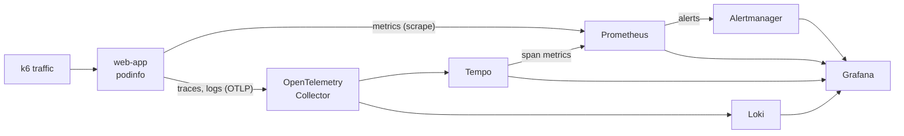

# Local observability lab

[← Observability](../README.md)

A complete open-source observability stack on your machine, with Docker Compose: the [web-app sample](../../kubernetes/apps/web-app/) (podinfo) sends metrics, traces, and logs, which flow through an OpenTelemetry Collector into Prometheus, Tempo, and Loki. Grafana shows all three, linked together, and Alertmanager receives the SLO alerts. A generated-traffic container produces a steady share of errors and slow requests, so the dashboards have something to show and the alerts fire.



## Run it

Docker with Compose v2, and about 2 GB of free memory. From the repository root:

```sh
docker compose -f observability/local-stack/compose.yaml --profile traffic up -d
docker compose -f observability/local-stack/compose.yaml ps
```

| Open | For |
|---|---|
| http://localhost:3000 | Grafana: dashboards in the Groundwork folder, and Explore |
| http://localhost:9090 | Prometheus: queries, targets (Status, then Targets), rules, and alerts |
| http://localhost:9093 | Alertmanager: firing alerts, silences |
| http://localhost:9898 | The web app itself |

Then follow the [Grafana 101 tour](../grafana/README.md#a-first-tour). With the default traffic (2% errors, 4% slow), the availability page alert fires within about five minutes, and the latency ticket after about 20.

```sh
# Change the traffic mix, for example to watch alerts resolve
docker compose -f observability/local-stack/compose.yaml --profile traffic stop traffic
docker compose -f observability/local-stack/compose.yaml --profile traffic run -d --rm \
  -e ERROR_PERCENT=0 -e SLOW_PERCENT=0 traffic

# Send your own app's telemetry: point its OpenTelemetry SDK at the collector
export OTEL_EXPORTER_OTLP_ENDPOINT=http://localhost:4317

# Reload Prometheus after editing rules in observability/prometheus/rules
curl -X POST http://localhost:9090/-/reload

# Stop, and delete all stored data
docker compose -f observability/local-stack/compose.yaml --profile traffic down -v
```

## What's in it

| File | What it configures |
|---|---|
| [compose.yaml](compose.yaml) | The services, pinned versions, and loopback-only ports |
| [otel-collector.yaml](otel-collector.yaml) | OTLP in; traces to Tempo, logs to Loki, OTLP metrics to Prometheus; memory limits and header redaction |
| [prometheus.yml](prometheus.yml) | Scrape targets (the app and the stack itself), the [SLO rules](../prometheus/rules/web-app-slo.yaml), and Alertmanager |
| [alertmanager.yml](alertmanager.yml) | Routing by severity, grouping, inhibition; receivers that notify no one |
| [tempo.yaml](tempo.yaml) | Single-binary Tempo on local disk, with span metrics and service graphs written to Prometheus |
| [grafana/provisioning/](grafana/provisioning/) | Data sources with fixed `uid`s and links between them (metrics to traces, traces to logs, logs to traces), and the dashboard loader |
| [traffic.js](traffic.js) | The k6 script that generates traffic, with `RATE`, `ERROR_PERCENT`, and `SLOW_PERCENT` settings |

Loki runs with the configuration built into its image, which accepts OTLP logs. The dashboards come from [../grafana/dashboards](../grafana/dashboards/), and the alert rules from [../prometheus/rules](../prometheus/rules/), so the lab tests the same files that would be used for real.

## How this maps to production

The lab trades safety for convenience, and says so in [compose.yaml](compose.yaml). In a real environment:

| The lab | In production |
|---|---|
| Static scrape target in `prometheus.yml` | Service discovery: a PodMonitor or ServiceMonitor ([Prometheus guide](../prometheus/README.md#in-kubernetes)) |
| One container of each component | Prometheus in pairs, Alertmanager clustered, Loki and Tempo in scalable mode on object storage, or managed services ([AWS](../aws/README.md#prometheus-and-grafana-on-aws), [Azure](../azure/README.md#prometheus-and-grafana-on-azure)) |
| Local disk volumes | Object storage (S3, Azure Blob Storage) for Loki and Tempo; remote write for long-term metrics |
| Anonymous Grafana admin | Single sign-on, Viewer by default ([Running Grafana](../grafana/README.md#running-grafana)) |
| Plain-text OTLP between containers | TLS, and authentication on the collector's receivers |
| Receivers that notify nobody | Paging and chat integrations, with secrets from files or a secret store |

## Troubleshooting

| Symptom | Check |
|---|---|
| A container keeps restarting | `docker compose -f observability/local-stack/compose.yaml logs <service>` |
| Dashboards are empty | Is the `traffic` container running? Is `web-app` up in Prometheus's Targets page? |
| No traces or logs | `docker compose ... logs otel-collector` for export errors. podinfo only exports when `--otel-service-name` is set. |
| Port already in use | Another local service holds 3000, 9090, 9093, 3100, 3200, 4317, 4318, or 9898. Stop it, or change the left-hand port in `compose.yaml`. |
| Alerts never fire | They need several minutes of traffic (the `for` durations). Check Prometheus's Alerts page for pending alerts. |
